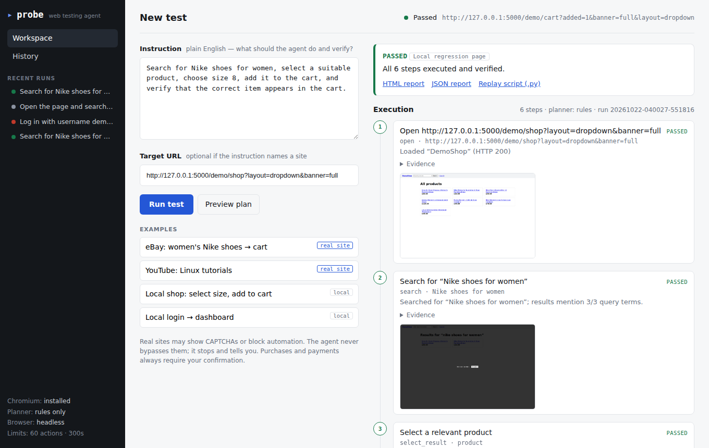
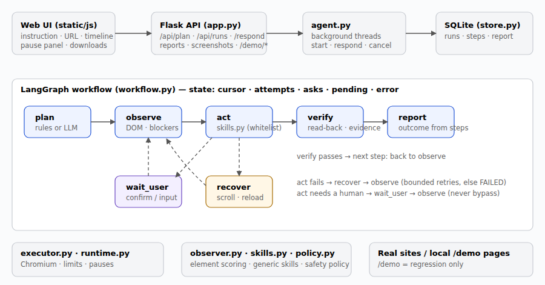
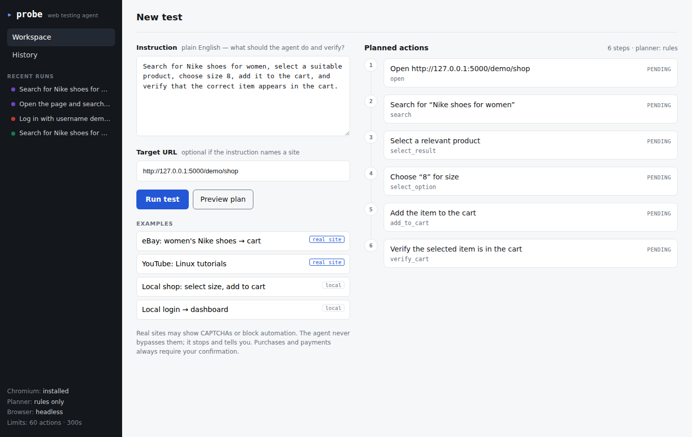
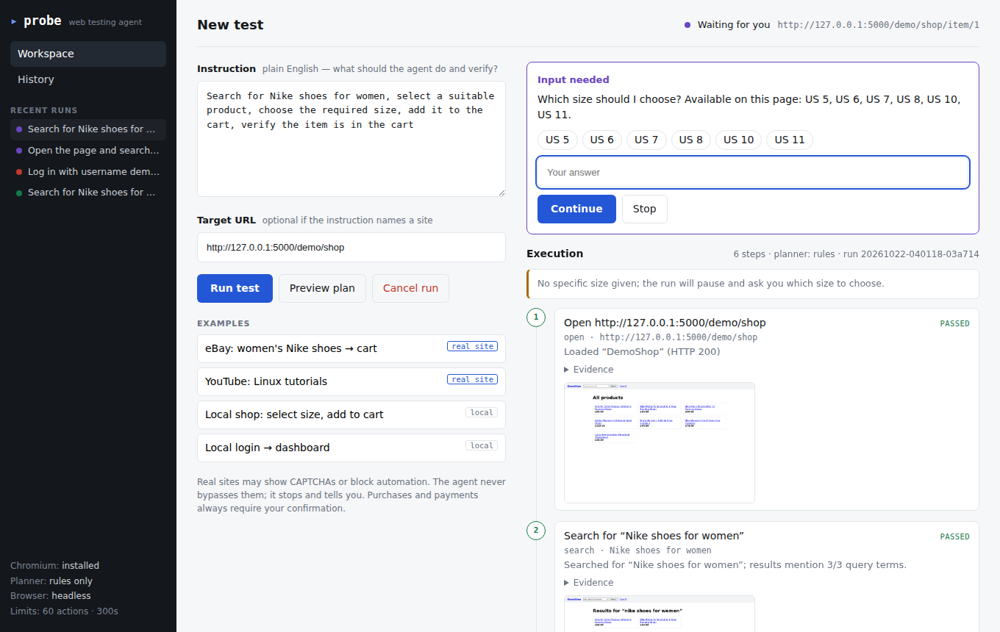
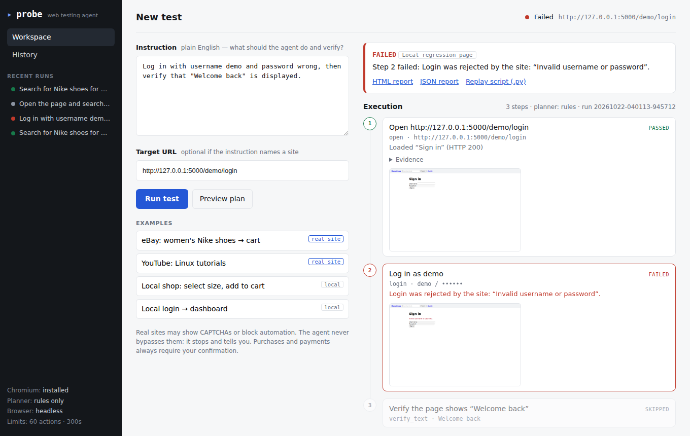

# Probe — AI web testing agent (natural language → real browser)

Describe a test in plain English; the agent plans it, drives a real Chromium browser with Playwright, **verifies what actually happened**, and produces evidence (screenshots, per-step details) and downloadable JSON/HTML reports.



## Verification status — read this first

| Area | Status | Evidence |
|---|---|---|
| Parser, validation, safety policy, storage, reports, API | **Verified** | 51 unit/API tests pass |
| Agent loop on the **local demo site** (3 option layouts, cookie overlay, delayed JS results, login, budget, errors, CAPTCHA wall, purchase confirmation, cancel) | **Verified (local regression)** | 22 browser tests pass, incl. UI tests |
| **eBay / YouTube / other real websites** | **NOT verified yet** | The environment this was built in had no outbound internet (DNS failed for ebay.com, youtube.com, even example.com), so no real-site run could be executed. `tests/test_real_sites.py` is ready; run it on your machine (below). |
| Optional LLM planner (Gemini) | **Untested** | No API key was available. Falls back to the rule parser on any failure. |

Local-demo passes are *regression evidence for the agent's mechanics only*. Every report labels its scope (`real_website` vs `local_regression`) from the hosts actually visited. Real sites change their DOM, A/B test, and often show bot walls; expect some real-site runs to end **BLOCKED** (reported honestly, never as a pass) or need heuristic tuning in `skills.py`.

## Quick start

```bash
python -m venv .venv && source .venv/bin/activate      # Windows: .venv\Scripts\activate
pip install -r requirements.txt
playwright install chromium
cp .env.example .env            # set BROWSER_HEADLESS=false to watch the browser
python app.py                   # http://127.0.0.1:5000
```

No API key is needed. Add `GEMINI_API_KEY` to `.env` only if you want the LLM planner for complex instructions.

### Try the real-site demonstration on your machine

```bash
BROWSER_HEADLESS=false python app.py     # then pick the “eBay” example in the UI
# or headless via tests (results are appended to data/real_site_results.json):
RUN_REAL_SITE_TESTS=1 pytest -m real_site -s
```
Run non-headless the first time: if a site shows a CAPTCHA the run pauses (“Waiting for you”); solve it yourself in the browser window and press **Continue**.

## What you can write

```
Open eBay, search for Nike shoes for women, select a suitable product, choose size 8,
add it to the cart, and verify that the correct item appears in the cart.

Open YouTube, search for Linux administration tutorials, open a relevant video, and verify that it loads.

Log in with username demo and password test1234, then verify that "Welcome back" is displayed.

Search for women under $50, select a suitable product, choose size 8, add it to the cart.
```
Tips: name the site or fill the *Target URL*; put expected text **in quotes** for a hard check; give concrete option values (“size 8”). If you leave a value vague (“choose the required size”), the agent asks you instead of guessing. **Preview plan** shows the validated steps without opening a browser.

## How it works



`plan → observe → act → verify → (recover | wait_user) → … → report`, coordinated by **LangGraph** (`workflow.py`).

* **Plan** — `parser.py` (rules, no key needed) or `llm_parser.py` (optional) emit a list of whitelisted, validated actions (`actions.py`). The LLM never writes code that gets executed.
* **Observe** — `observer.py` snapshots visible interactive elements (text, labels, roles, price, container context) and page state; blocks/CAPTCHAs are detected.
* **Act** — `skills.py` has generic skills (`search`, `select_result`, `select_option`, `add_to_cart`, `login`, `apply_filter`, `click`, `type`, `verify_*`). Elements are found by scoring the live page against the *description* — there are no per-site scripts.
* **Verify** — each skill reads back the outcome: search results mention the query; the opened page matches the chosen title; a dropdown/select reads back the chosen value; add-to-cart needs a confirmation signal; **`verify_cart` opens the real cart and matches the product** (item id / title words) and reports the matched evidence.
* **Recover** — bounded retries: dismiss overlays, scroll, reload, try the next candidate result. Unrecoverable → clear failure.
* **Report** — outcome derived strictly from step results: `PASSED` (all verified) · `INCONCLUSIVE` (some steps could not be machine-verified) · `FAILED` · `BLOCKED` (human needed / declined) · `CANCELLED`. Steps never reached are `skipped`, never `passed`.

### Safety
* Only `http/https`; private/link-local/internal addresses blocked (localhost allowed for the demo); optional `BLOCKED_DOMAINS`.
* **Never bypasses CAPTCHAs or access controls** — pauses for a human; gives up after 3 unresolved attempts.
* **Purchases/payments/checkout** (“Buy it now”, “Place order”, …) require explicit confirmation in the UI; declining stops the run. The agent never adds checkout steps on its own.
* Limits: `MAX_TOTAL_ACTIONS`, `MAX_STEP_RETRIES`, `RUN_TIMEOUT_S`, `USER_RESPONSE_TIMEOUT_S`. Credentials are masked everywhere (UI, DB, reports) and requested if missing, never invented.

## Interface
Workspace (instruction, URL, examples, plan preview, live timeline with current action, browser URL, status, errors, evidence and screenshots, pause panel for confirmations/inputs) · History (persistent, SQLite) · Downloads: HTML report (self-contained, screenshots embedded), JSON report, and a replay Playwright script generated from recorded selectors.

| Plan preview | Waiting for input | Failed run |
|---|---|---|
|  |  |  |

## Tests
```bash
pytest -m "not real_site"      # 73 tests: unit, API, browser regression (local demo), UI (~2 min)
pytest tests/test_parser.py tests/test_actions_policy.py tests/test_store_reporter.py tests/test_api.py   # fast, no browser
RUN_REAL_SITE_TESTS=1 pytest -m real_site -s     # real websites (needs internet)
```
`tests/test_browser_regression.py` is explicitly *local regression*. `tests/test_real_sites.py` reports PASSED, or BLOCKED as an xfail — never a silent pass.

## Project layout
```
app.py            Flask API + UI host        workflow.py   LangGraph state machine
agent.py          run manager (threads)      executor.py   Chromium session + run lifecycle
parser.py         rule-based planner         llm_parser.py optional Gemini planner
actions.py        action schema/validation   policy.py     URL + consequential-action + CAPTCHA policy
observer.py       page snapshot + scoring    skills.py     generic browser skills
runtime.py        per-run state, pauses      store.py      SQLite
reporter.py       outcome, JSON/HTML         code_generator.py  replay-script export
demo.py           local regression sites (/demo/*)         templates/, static/   UI
```
Legacy pages `/login_page`, `/form_page`, `/success_page` and the old form phrase (“fill the form with name as …”) still work.

## Known limitations
* Heuristics, not magic: unusual widgets (shadow DOM, iframes, canvas, heavily customised dropdowns) may not be found; the step then fails with a clear message.
* Option verification relies on what the page exposes; if no selected state is readable the step is `unverified`, making the run `INCONCLUSIVE` rather than `PASSED`.
* Add-to-cart that shows no confirmation is `unverified` until `verify_cart` confirms the contents.
* The LLM only *plans*; it does not choose elements at runtime. Vague claims (“looks professional”) are reported `unverified`.
* Bot protection on large sites may block automation; the agent stops rather than evading it. Respect each site's terms of service.
* Max two concurrent runs; iframes are not traversed.
